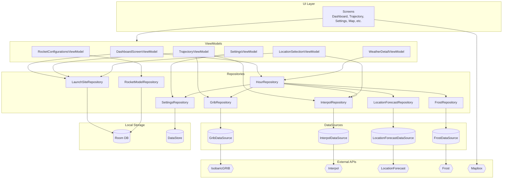

<h1 align="center">Architecture</h1>

<p align="center">
  
</p>

_This document is intended for developers who will maintain, extend, or onboard onto this codebase. It describes the architecture, project structure, and design decisions made during development._

## Project Structure Overview

The app follows a layered architecture with three main layers:

```
├── ui/                 # Presentation layer (Screens, ViewModels)
├── data/               # Data layer (Repositories, DataSources)
└── model/              # Domain models (data classes)
```

### UI Layer (Presentation)
Screens built with Jetpack Compose, each paired with a ViewModel:
- `DashboardScreen` / `DashboardScreenViewModel` — main viability overview and hour selection
- `TrajectoryScreen` / `TrajectoryViewModel` — trajectory simulation display
- `TrajectorySetupScreen` / `TrajectorySetupViewModel` — rocket config and launch setup
- `HomeMapScreen` / `HomeMapScreenViewModel` — full-screen map with launch site markers
- `LocationSelectionScreen` / `LocationSelectionViewModel` — add/edit launch site locations
- `SettingsScreen` / `SettingsViewModel` — user preferences and thresholds
- `WeatherDetailScreen` / `WeatherDetailViewModel` — detailed weather breakdown for an hour
- `ForecastScreen` — 72-hour forecast view (uses `DashboardScreenViewModel`)

Shared ViewModels (not tied to a single screen):
- `RocketConfigurationsViewModel` — manages saved rocket configurations
- `MapStyleViewModel` — shared map style state across map screens

### Data Layer

**Repositories** abstract data sources and expose data to ViewModels:
- `HourRepository` — **central aggregator** that combines data from multiple sources to build hourly weather snapshots with viability scores
- `GribRepository` — selects between GRIB1 (Europe) and GRIB2 (Southern Norway) decoders for atmospheric data
- `InterpolRepository` — fetches vertical atmospheric profiles from Interpol API
- `LocationForecastRepository` — ground-level weather from MET LocationForecast
- `LaunchSiteRepository` — persists user launch sites via Room
- `RocketModelRepository` — persists rocket configurations via Room
- `SettingsRepository` — user preferences via DataStore
- `FrostRepository` — historical weather data from Frost API

**DataSources** handle raw API calls and file parsing:
- `GribDataSource`, `Grib1Decoder`, `Grib2Decoder` — binary GRIB file fetching/parsing
- `InterpolDataSource` — Interpol API calls
- `LocationForecastDataSource` — LocationForecast API calls
- `FrostDataSource` — Frost API calls

### Model Layer
Pure data classes representing domain objects:
- `AtmosphericLayer` — wind, temperature, pressure at a given altitude
- `TrajectoryPoint`, `TrajectoryResult` — simulation output
- `HourData`, `WatchedHour`, `HourChange` — hourly weather snapshots and change tracking
- `LaunchSite`, `RocketModel` — user-configurable entities
- `LaunchWindowLimits` — threshold settings for viability calculation
- `ForecastEntry` — parsed LocationForecast data
- `InterpolUnits` — parsed Interpol vertical profile data

## Simplified Architecture Diagram



## Design Principles

### MVVM (Model-View-ViewModel)
Each screen has a dedicated ViewModel that:
- Holds UI state as `StateFlow`
- Exposes actions as functions
- Never references Android UI components directly

This separation allows UI and business logic to be developed and tested independently.

### UDF (Unidirectional Data Flow)
Data flows in one direction: **DataSource → Repository → ViewModel → UI**

User actions flow back up through ViewModel functions, which update state and trigger recomposition. The UI never directly modifies data sources.

### High Cohesion
Each class has a single, well-defined responsibility:
- Decoders only parse data
- Repositories only coordinate data access
- ViewModels only manage UI state
- Screens only render UI

### Low Coupling
Dependencies are injected via constructor, not created internally. `ParalaxApplication` acts as a manual dependency injection container, creating singletons for repositories and data sources. ViewModels receive their dependencies through factory constructors.

This means:
- Components can be tested in isolation with mocks
- Swapping implementations (e.g., a different weather API) requires changes in one place
- No circular dependencies between layers

## Native Code (C/JNI)

GRIB2 decoding uses the ecCodes C library via JNI:
- `NativeGribBridge.kt` — Kotlin interface to native code
- `gribbridge.c` — JNI implementation calling ecCodes
- Pre-built static libraries in `app/src/main/cpp/prebuilt/arm64-v8a/`

Only `gribbridge.c` should be modified. The `.a` libraries are pre-compiled binaries for ecCodes and OpenJPEG.

## Technologies

| Technology | Purpose |
|------------|---------|
| Jetpack Compose | Declarative UI framework |
| Navigation Compose | Type-safe screen navigation |
| Room | Local SQLite database for launch sites and rocket models |
| DataStore | Preferences and settings persistence |
| KTOR | Async HTTP client for API calls using the Kotlin native CIO engine |
| Mapbox | Interactive maps and geocoding |
| ecCodes (C) | GRIB2 binary weather data decoding |
| OpenJPEG (C) | JPEG2000 decompression for GRIB data |

## API Level

**minSdk: 29 (Android 10)**  
**targetSdk: 36 (Android 16)**

We chose Android 10 as the minimum to:
- Support ~95% of active Android devices
- Use modern APIs (e.g., scoped storage, improved location permissions)
- Avoid legacy compatibility code for older versions

The NDK build currently targets only `arm64-v8a` (64-bit ARM), which covers most modern phones and emulators.

## Navigation

Navigation uses Jetpack Compose Navigation with type-safe routes. Screen destinations are defined as serializable `Screen` objects in `MainActivity.kt`. The navigation graph is declared declaratively in Compose.

## External APIs

All MET Norway APIs require a `User-Agent` header (set in `MetClient`):

| API | URL | Purpose |
|-----|-----|---------|
| IsobaricGRIB | `in2000.api.met.no/weatherapi/isobaricgrib/1.0` | GRIB1/GRIB2 atmospheric data |
| LocationForecast | `api.met.no/weatherapi/locationforecast/2.0` | Ground-level weather |
| Interpol | `interpol.met.no` | Vertical atmospheric profiles |
| Frost | `frost.met.no` | Historical observations |
